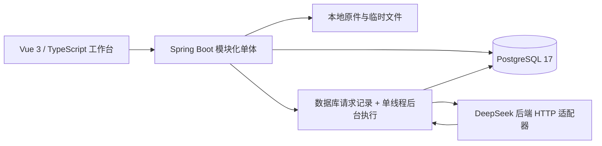

# 项目事实库

标记：F=事实，I=推断，G=待补证据。来源编号见 [01](01_文档摘要与来源索引.md)。事实进一步注明设计、实现或验证记录。

## 业务与核心流程

| ID | 类型 | 事实/判断 | 来源与边界 |
| --- | --- | --- | --- |
| F01 | 事实·设计 | AgentCV 面向已有中文简历、需维护多个目标版本的人，单操作者自用与演示 | D01 §1；不是开放注册、多租户协作 SaaS |
| F02 | 事实·设计+实现记录 | 三类对象分离：工作区简历、个人参考材料、明确确认背景 | D02、S01—S07；用户确认不是外部真实性认证 |
| F03 | 事实·实现+验证记录 | 上传/粘贴预览修正建立简历，自动保存重开；同人复制后独立编辑，不复制聊天或材料关系 | S01/S02/S09 |
| F04 | 事实·实现+验证记录 | 人物材料默认不参考，多区关系共用，单区停止不删材料；正文更新不改原件 | S03；仅管理资料不触发模型 |
| F05 | 事实·实现+验证记录 | 主动发送→版本和范围校验→快照受理→后台模型调用→保存回答→前端查询 | S04、C03；刷新查询原请求，不自动重发 |
| F06 | 事实·实现+验证记录 | 模型提炼候选→展示用途和正文→用户确切确认→保存对应部分→同人跨区复用→纠正/撤回 | S06/S07/S09；完整真实模型全流程走读仍缺 |
| F07 | 事实·实现记录 | AI 提供建议，不自动写回简历；用户手工修改保存，最终复制到外部工具排版导出 | D02、S09 |
| I01 | 推断 | 核心产品价值在资料复用和结果可控，而不是比强模型生成质量更好 | D01/D02；省时省钱收益未验证 |

## 架构与技术栈

| ID | 类型 | 内容 | 来源与边界 |
| --- | --- | --- | --- |
| F08 | 事实·依赖+设计 | Java 17、Spring Boot 3.5.16、Spring Web/JDBC/Security、Flyway、POI、PDFBox；前端 Vue 3/TypeScript/Vite | C01/C02；PostgreSQL 17 由 D04 与 S08 环境记录支持，非 pom 驱动版本推断 |
| F09 | 事实·实现 | 单体内按工作区、材料、背景、对话、模型、文件分职责；JDBC/TransactionTemplate 执行业务 SQL 与短事务 | D04、C03；不是微服务或完整领域驱动架构认证 |
| F10 | 事实·实现 | 后台单线程调度，数据库持久任务；全局受理上限默认 4，同区一次一条 | S08、C03；不是并行 4 线程，也不是吞吐指标 |
| F11 | 事实·实现 | 行锁、版本条件、复合外键、唯一约束和幂等指纹共同控制并发及归属 | S01/S03/S07、C03；不同模块约束不同，不宣称所有接口已全面审计 |
| F12 | 事实·实现 | 服务端 Session、BCrypt、CSRF、归属校验、受保护下载 | S01/S02/S08；单机受保护环境，未证明公网安全完备 |
| F13 | 事实·实现 | TXT、DOCX、文本层 PDF；随机存储键；临时文件→DB文本/PENDING→原子移动→READY | S02/S03；无 OCR、无排版还原、无恶意文件沙箱 |
| F14 | 事实·设计边界+代码核对 | 未引入 Redis、MQ、向量数据库、Agent 编排框架；当前后端 HTTP 直接接一个模型服务商 | D04、C01、C03/C04；不能写 LangChain/LangGraph/Spring AI/RAG/多 Agent/Function Calling |

## 可靠性与 AI 机制

| ID | 类型 | 内容 | 来源与证据 |
| --- | --- | --- | --- |
| F15 | 事实·实现+验证记录 | 受理时固定简历/材料/有效背景和历史；basis_json 记录版本清单；变更后旧回答提示，下一次用新依据 | S04/S07、C03；延迟替身输入断言 |
| F16 | 事实·实现+验证记录 | 必需资料超预算拒绝；历史选近期完整问答；分隔后不再发旧聊天，清空与分隔语义不同 | S05、C03；192 KiB 是 UTF-8 本地输入预算，不是精确 token 计数 |
| F17 | 事实·实现+验证记录 | 候选、确认、有效背景分离；绑定展示正文、候选版本、代次、归属；确认重试仅写库 | S06；有限确认语法和显式按钮，不是通用自然语言意图识别 |
| F18 | 事实·实现+验证记录 | ACCEPTED 原子领取进入 CALLING，再外部调用；结果与记录状态分离；未知结果不自动重调 | C03/C05、S04/S08；不保证供应商恰好一次 |
| F19 | 事实·实现+验证记录 | 回答先放进程内暂存，再落库；保存失败可查询/复制/只重试保存；重启丢失如实提示 | S04/S08；不是持久结果缓存或回答零丢失 |
| F20 | 事实·实现+验证记录 | HTTP 完整响应 60 秒期限、连接 15 秒、接收中 2 MiB 限制；停止等待后以状态条件拒绝迟到结果 | S06/S08、C03/C04；排队另计，响应超大专项测试未见记录 |
| F21 | 事实·实现+验证记录 | 启动先取单机文件锁，再恢复遗留 CALLING；清理依赖业务引用，DB 不可读则不删除 | S08、C05；同锁路径单实例，不支持跨机器协调 |
| F22 | 事实·实现+验证记录 | 发送起始固定 submitted，异步检查后仍发送原文字；内容匹配才清空，保留新草稿 | S09、C06；POST 正文与刷新恢复浏览器断言 |
| F23 | 事实·缺陷与修订记录 | HTTP200 空回答确认存在；移除强制 response_format 并保留候选严格校验 | S09、C03/C04；供应商内部根因未证实，修订后真实效果待复测 |

## 验证与指标证据

| ID | 类型 | 可引用证据 | 不能推导的结论 |
| --- | --- | --- | --- |
| F24 | 事实·验证记录 | S09 记录一次 52 项后端测试通过，0失败/错误/跳过；前端类型检查与构建通过 | 不等于 100% 覆盖率，不保证随后空回答修订均已重跑同规模测试 |
| F25 | 事实·验证记录 | m01/m02/m03/m04-layout/m05/m06/m07 七个浏览器分片通过；部分含 fixture | 不能全称真实供应商端到端验收 |
| F26 | 事实·验证记录 | S04 一次合成真实调用约 2.15 秒，120输入/56输出 tokens，刷新恢复 | 非平均/P95/高并发性能，非单请求实际金额 |
| F27 | 事实·验证记录 | S06 本地 HTTP 正文阻塞，800ms 测试期限，3秒内退出，仅 1 次请求 | 是故障用例断言，不是生产模型延迟保证 |
| F28 | 事实·验证记录 | S08 独立随机 schema/JAR 重启、强杀及跨进程锁实验 | 不是完整指令级崩溃矩阵或多实例高可用 |
| F29 | 事实·验证记录 | S09 串联用例真实数据库 + 3 次计数替身调用 | 3 次不是付费真实模型统计，不是业务转化指标 |
| G01 | 待补证据 | 完整任务耗时、操作次数、返工、按任务限定真实模型用量/费用及网页版对照 | 暂不写节省 XX%、费用降低 XX% |

## 开发过程及贡献归属

| ID | 类型 | 已知内容 | 归属判断 |
| --- | --- | --- | --- |
| F30 | 事实·过程记录 | D05 规定纵向切片；S01—S09 记录实现、失败、用户反馈与回归 | 可证明项目过程，不能证明全部代码由本人手写 |
| F31 | 事实·过程记录 | 文档多次记录用户提出交互反馈、确认体验和授权推进 | 证明需求反馈/体验参与；不足以推出每项架构决策的个人所有权 |
| F32 | 事实·过程记录 | 文档记载“助手自动化验证”、开发侧修复、fixture 等 AI 辅助执行痕迹 | 需本人说明自己承担的设计、编码、审查、测试及 AI 工具分工 |
| G02 | 待补证据 | 本人职责、团队规模、协作者、AI 辅助范围、本人能解释和复现的机制 | 当前没有可确认的团队成果分配；不编造团队，也不默认独立开发 |
| I02 | 推断·贡献候选 | 若本人确有对应决策与验证参与，可突出资料边界建模、状态/事务设计、故障定位及回归闭环 | 投递前逐项确认；详见两版模块的贡献核实表 |

## 风险与缺失信息

- G03：旧简历正文、项目起止时间、期望职级未提供，不能生成完整替换后的个人简历或任职年限。
- G04：Agent/AI JD、名扬智能集团 JD/业务/具体团队未提供，岗位匹配仅为通用能力判断。
- G05：真实模型完整提炼—确认—跨区—纠正/撤回—冲突澄清页面证据不足；空回答修复效果待复测。
- G06：API 专属数据处理条款、完整日志/秘密扫描、真实 DB 故障组合、负载/SQL执行计划、备份恢复演练缺证据。
- G07：测试/正式执行器早期曾竞争，后续按 schema、模型标识及文件目录隔离；保留事故教训，不倒推历史绝无外发。
- G08：候选确认有限语法、长期变更说明与幂等墓碑增长、单实例本地文件、内存回答重启丢失均为已知限制。

上述缺口不否定已有实现及验证记录，但限制了效果、可靠性和个人职责的宣称范围。