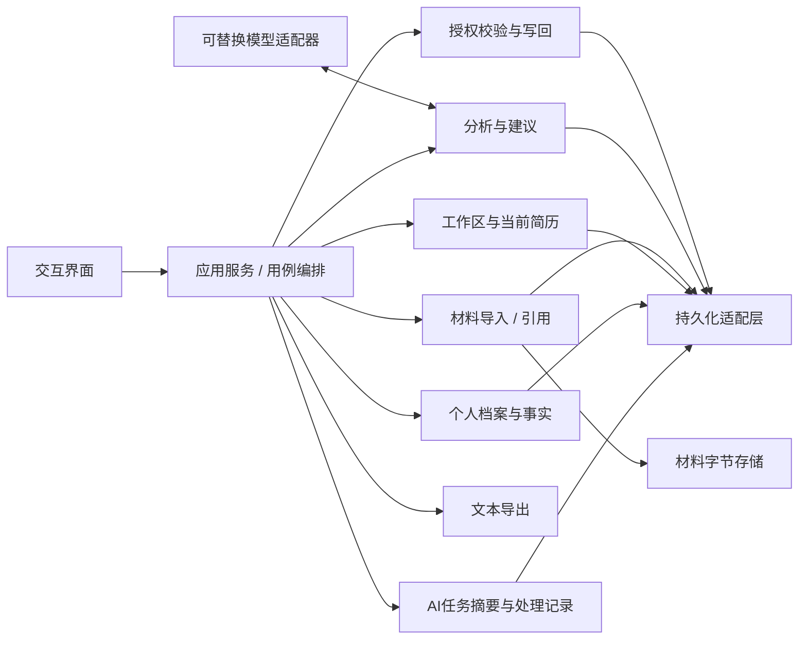
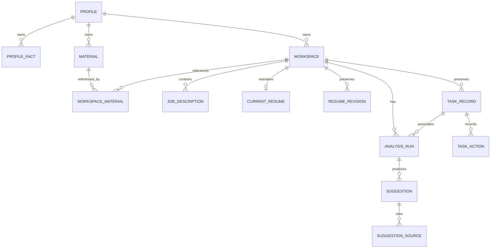

# AgentCV 系统设计说明（草案）

> 状态：已按正式R01—R11及B01—B03对齐。整体方向及技术基线方向已获用户确认；具体版本、兼容性和下述详细机制仍待验证/评审，不等于完整设计已验收。不授权开始开发。

## 1. 设计目标与约束

### 1.1 目标

- 将已确认的 R01—R11 需求映射到可实现、可测试的模块、数据关系、状态与失败处理。
- 保证个人档案、工作区、材料引用、事实确认、建议授权和简历写回边界可由程序执行，而非只依赖模型提示词。
- 首轮支持本人本机/局域环境，不开放公网；如通过网络访问，必须有访问保护。
- 新版本独立重建；旧 AgentCV 只读保留，旧模块按需求和验证结果择优参考。

### 1.2 已冻结的工程输入

- 主开发环境与主工作树：WSL Linux。
- 起步技术组合：Java 17 + Spring Boot 3.5。
- 首轮导入：纯文本、`.docx`、含文本层的 PDF；不支持 `.doc`、扫描件 PDF/OCR。
- 首轮导出：纯文本为硬性要求，PDF/Word 导出可选。
- 业务验收与效果声明边界以[第一轮需求分析](02_需求分析_第一轮需求.md)为准。

## 2. 建议的逻辑架构

### 已确认的整体方向

用户已确认：简历工作台结合自然对话、修改对照与AI任务摘要回看；AI按用户任务选择必要的分析、追问和建议步骤，程序控制上下文、归属、版本、授权及实际变更。不预设多Agent或完全自主执行。前端、存储、文件解析与模型接入均在设计阶段讨论，不因确认Spring Boot而提前启动开发。

### 已确认的技术基线方向（待兼容验证）

用户选择兼顾学习与面试展示，接受一定环境配置成本，并已接受以下方向：

| 范围 | 已接受方向 | 尚未完成的验证/决定 |
| --- | --- | --- |
| 前端 | Vue 3 + TypeScript + Vite，构建后由Boot同源托管 | Node与工具版本、构建集成、界面状态及错误反馈 |
| 后端 | Java 17 + Spring Boot 3.5，按业务职责分模块 | 精确补丁版本与依赖组合、运行配置 |
| 业务数据 | PostgreSQL + Spring JDBC + Flyway | PostgreSQL/驱动/迁移模块版本、事务与备份恢复 |
| 原始材料 | 本地受控目录；数据库保存元数据、确认文本和业务记录 | 文件与数据库一致性、路径隔离、清理和备份 |
| 文件解析 | POI XWPF + PDFBox | 版本、许可证及依赖核查，中文、多栏、表格、异常样本验证 |
| 模型接入 | 优先LangChain4j，应用负责受约束编排 | 供应商/API能力、版本、工具调用与结构化输出验证 |

以上是选型方向批准，不是软件已安装或兼容测试通过。暂不因面试目的增加Redis、消息队列、向量数据库或多Agent框架。数据与状态详细设计见[07_数据与状态契约_草案.md](07_数据与状态契约_草案.md)。

### 选型比较依据（保留决策前的取舍）

| 领域 | 候选与取舍 | 决策前建议（最终方向以上表为准） |
| --- | --- | --- |
| 前端 | 原生HTML/JS少构建步骤，但工作区、保存状态、建议失效和对照等联动需自行管理；Vue组件化有利于拆分交互，也增加Node构建和学习成本；React同样可行，不能仅凭功能判定优劣 | Vue 3 + TypeScript + Vite方向已确认；构建产物由Boot同源托管，不要求独立前端服务器部署 |
| 业务存储 | JSON文件简单但事务、关联和迁移要自行处理；H2文件模式减少独立数据库服务；PostgreSQL增加运行维护但适合显式关系约束和常规数据库展示 | PostgreSQL方向已确认，Spring JDBC显式SQL与Flyway迁移已确认；精确版本和兼容待验证 |
| 材料存储 | 数据库内存储可简化事务关联但增加库体积；本地文件与元数据分离便于保存原件，但需处理文件/数据库操作一致性及孤立文件清理 | 候选为本地受控目录保存原文件，数据库存元数据、确认文本和业务记录；具体清理/备份契约待验证 |
| 文件解析 | POI XWPF读取docx，PDFBox提取PDF文本；统一解析包装层也可评估，但不能由格式数量推出必须增加组件 | 首先评估POI XWPF与PDFBox，使用共同解析接口；中文、多栏、表格与失败检测须用样本验证，不承诺OCR或完整排版 |
| 模型接入 | 直接HTTP便于控制协议但需自行处理工具调用/结构化输出等；LangChain4j可参考旧项目经验；Spring AI不与其同时引入 | 优先LangChain4j接入方案A；业务控制留在程序中，不由框架自动获得写权限；供应商协议和具体版本待验证 |

选型依据应包含需求适配、本人掌握程度、部署调试成本、兼容性及验证结果；上述建议不是已安装或已使用的库，不授权实现代码引用。

官方资料核查：

- [Vue介绍](https://vuejs.org/guide/introduction.html)：支持渐进使用和组件化；完整应用推荐单文件组件，不据此声称必然优于React或原生JS。
- [Boot 3.5 SQL支持](https://docs.spring.io/spring-boot/3.5/reference/data/sql.html)：提供JDBC/DataSource及嵌入式数据库支持，具体数据库与持久化模式需单独配置验证。
- [POI XWPF指南](https://poi.apache.org/components/document/quick-guide-xwpf.html)：支持docx主要内容和文本提取，但API并不完整，不证明任意中文文档都可靠解析。
- [PDFBox入门](https://pdfbox.apache.org/3.0/getting-started.html)：提供依赖接入资料；本次该页不足以单独证明Java最低要求或阅读顺序质量，后续补查并测试。
- [LangChain4j Boot集成](https://docs.langchain4j.dev/tutorials/spring-boot-integration/)：官方区分Boot 3与Boot 4 starter，说明Java 17、Boot 3.5+支持；示例版本不是本项目选定版本，仍需依赖与供应商验证。

候选方案为**单体应用、按业务边界分模块**，先避免为单人本地演示引入分布式组件。该方案是设计建议，不是已确认实现选型。



### 2.1 逻辑职责

| 模块 | 职责 | 不得承担的责任 |
| --- | --- | --- |
| 交互界面 | 档案/工作区导航、导入检查、JD 选择、建议对照、明确授权、保存/错误状态 | 自行判定事实已确认或绕过服务端授权 |
| 应用服务 | 编排用户用例、验证对象归属、控制事务边界 | 将模型输出直接当作持久化命令执行 |
| 档案与事实 | 档案生命周期、事实状态、用户确认/纠正/撤回、回收站 | 认证现实真实性 |
| 工作区与简历 | 工作区目标、当前简历、线性历史、历史恢复 | 让一个工作区的修改覆盖其他工作区 |
| 材料服务 | 格式校验、提取、检查确认、重复提示、引用、材料回收站 | 未确认提取文本进入分析上下文 |
| 分析服务 | 基于用户明确选择的简历、事实、引用材料与 JD 形成带来源的建议 | 自动启动分析、确认事实或写回简历 |
| 写回服务 | 验证建议状态、目标版本、范围、事实依赖和用户授权后应用变更 | 仅凭自然语言模型解析结果绕过授权和版本检查 |
| 导出服务 | 已保存时导出当前稿；未保存时明确导出页面文本并保持未保存状态 | 静默导出旧稿，或将导出成功当成保存成功 |
| 任务记录服务 | 保存并回看用户目标、AI关键判断、简要依据/未知和处理结果 | 将摘要当成事实依据，或用AI概括伪造实际写回/保存状态 |
| 模型适配器 | 隔离供应商/API 差异，返回结构化候选结果 | 拥有业务对象写权限、决定最终状态 |
| 持久化/文件适配层 | 屏蔽具体数据库、文件存储实现 | 在需求尚未验证前绑定复杂基础设施 |

## 3. 核心数据关系（逻辑模型）



### 3.1 逻辑实体

| 实体 | 关键属性/约束 |
| --- | --- |
| Profile | 身份档案；是不同人数据隔离的根边界；可进入回收站 |
| ProfileFact | 内容、确认状态、陈述来源、创建/纠正/撤回记录；不表示现实认证 |
| Material | 档案所属；原文件/文本、提取文本、格式、提取状态、用户检查确认状态；内容修订可区分，不能用旧修订确认放行新内容；可进入回收站 |
| Workspace | Profile 子对象；岗位方向、目标描述、生命周期；一份当前简历；可进入回收站 |
| WorkspaceMaterial | Workspace 与 Material 的显式引用关系；记录有效状态和采用的材料修订；只有有效且已检查确认的引用才可作为分析输入 |
| JobDescription | Workspace 子对象；JD 文本及其导入/确认状态；仅用户本次选中的 JD 集参与分析 |
| CurrentResume | Workspace 当前可编辑稿；带单调递增修订号或等价并发检查标识 |
| ResumeRevision | 简历内容快照、来源类型、时间、操作说明；支持查看和恢复，线性追加 |
| AnalysisRun | 用户明确发起的一次分析；绑定档案/工作区、简历修订、背景快照、材料引用集、所选 JD 集和模型版本信息 |
| Suggestion | 候选修改、目标范围、依据、未知/冲突、来源分析、目标简历修订、状态及失效原因 |
| SuggestionSource | 建议到事实/材料修订/引用/JD等依据的关系；用于写回检查及依赖变化提示，来源存在不等于语义真实 |
| TaskRecord | 工作区内一次用户任务的目标、时间、原简历修订、所选JD/方向、实际材料身份/修订、公开判断摘要与未知项；无分析或无改稿的追问任务也可记录 |
| TaskAction | 用户采用/拒绝/待处理、授权范围、写回结果、保存结果及对应简历修订；结果由程序实际操作产生，不由摘要模型猜测 |
| RecycleEntry | 被删除档案/工作区/材料的对象类型、归属、删除时间和恢复关联；保留期限是设计参数 |

实体字段、主键、索引、数据库类型及原文件存储形态待技术验证后形成正式逻辑/物理数据字典。

工作区初建且尚未选定简历时允许没有当前稿；选定后只维护一份。当前简历是独立工作文本，原材料是其来源，不是跨工作区共享的可变稿。来源材料与当前稿的关联须保留，以执行“材料仍作为当前简历时先更换再移除”的规则；具体关联终止条件留详细设计评审。JD跨区共用采用同档案来源的显式引用或独立副本候选，物理存储方式尚未选定，不因复制简历自动带入。

## 4. 核心状态与不变量

### 4.1 材料处理

```text
待导入 → 格式/容量校验 → 提取中
  → 提取失败/不支持/无文本/超限（不得分析）
  → 提取完成待检查 → 用户修正（可选）→ 用户检查确认
  → 未引用（不进入上下文）→ 用户明确引用到工作区 → 可作为分析输入
  → 用户移除并确认 → 回收站 → 用户恢复（重新检查引用关系）
```

不变量：材料内容检查确认不代表经历事实确认；文件恢复不自动恢复分析引用；作为当前简历的材料不能直接移除。

材料更新生成新内容修订并要求重新检查确认；旧内容不自动用于新分析。撤销引用/移除使引用不可用，并暂停依赖该材料的未采用建议；更新材料暂停依赖旧内容的建议。新分析只使用有效且确认的内容，不自动分析。已保存简历不自动改动，历史任务保留原来源身份并显示变化状态；源文件不可用时提示不可用，不能承诺仍可打开原文件。

### 4.2 分析与建议

```text
用户明确发起
  → 捕获输入快照（简历修订、事实、有效引用、明确选择的 JD 集）
  → 分析运行中 → 完成 / 部分失败 / 失败
  → 建议待用户处理 → 采用 / 拒绝 / 调整后重提 / 因上下文变化暂停
```

- 导入、选择/切换 JD、背景变化本身不启动分析。
- 建议必须绑定来源分析及目标简历修订；保存其来源类型（简历自述、用户确认事实、已引用材料、JD、参考分析等）。
- 目标改变：旧分析可查看，旧建议暂停采用；按新目标重分析后必须重新授权。
- 简历原文修订或依赖事实失效：旧建议不得以过期授权写回。
- 输入材料修订、引用状态及JD目标也须在模型结果返回和建议采用时重新检查；运行期间发生变化的结果保留为历史并标明已过期，不可直接采用。
- 模型调用异常不能生成“成功”状态；已保存简历保持不变。

### 4.3 受控写回

1. 用户明确授权：界面操作或对象/范围明确的自然语言授权。
2. 服务端验证档案、工作区、建议、目标简历修订、授权范围和依赖状态。
3. 原文/事实依赖未变化且验证通过时，按用户授权的范围应用修改。
4. 在一个一致性事务中更新当前稿并追加历史快照/修改记录；事务失败时不得显示写回成功。
5. 只有清楚自然语言事实陈述可同步为已确认事实；建议采用、润色、保存和简历替换不能确认事实。

自然语言授权由对话层解析为候选对象和范围；指向唯一明确时按同等程序校验执行，不强制额外重复确认；有歧义则先澄清。操作后展示实际结果，具体指代识别需通过原型和异常案例验证。

### 4.4 删除与恢复

- 档案删除：确认后将档案及归属对象作为一个可恢复删除单元；不得影响其他档案。
- 工作区删除：确认后将该工作区及归属内容作为可恢复单元；档案与其他工作区保持有效。
- 材料移除：显示全部引用工作区；确认后解除引用并移入回收站。若材料为当前简历，先更换当前简历。
- 恢复档案/工作区/材料需恢复其所有权关联并重新检查有效性；不应让被回收的内容静默进入分析。精确级联和恢复冲突策略待设计验证。
- 回收站期限、到期清除、备份清除和恢复冲突处理均为待确认设计参数；不能承诺超出实际存储机制的数据擦除能力。

### 4.5 保存、历史与导出

- 当前简历自动保存，界面状态至少区分保存中、已保存、未保存/失败。
- 保存失败时保留页面内存内容并给复制/文本兜底；未保存离开时阻止静默切换，用户可重试或复制后明确离开。
- 历史版本采用线性快照；恢复历史稿通过创建新的当前修订实现，不改写旧历史、不回滚 ProfileFact、不重启旧建议。
- 已保存时导出当前稿；存在未保存编辑时，从当前页面捕获文本快照用于复制/下载，明确标记未保存，不用服务端旧稿冒充页面稿。下载文件采用纯文本，保存状态通过界面及文件名等元信息表达，避免向简历正文插入状态提示。导出失败不改变工作稿，成功也不改变未保存状态。
- 历史快照的具体生成时机、自动保存节流和冲突策略待设计验证。

### 4.6 AI任务摘要与操作结果

- 每个任务保留简短的公开判断说明；保存目标、输入简历修订、所选JD/方向、实际使用材料和未知项，不要求完整模型请求、提示词版本、Token或隐藏思维链。
- 初次分析、补充后的追问或建议可关联同一任务；是否已采用、是否写回、是否持久化必须分别取自程序实际结果。
- 已保存摘要在重新打开工作区后可回看；摘要失败单独显示“记录未保存”，不得回滚已经成功保存的简历，也不得因摘要成功就声称简历已保存。
- 写回成功的关键操作结果建议与新简历修订同事务记录；文字摘要可独立补记。摘要失败重试只重试记录，不重复调用模型、重复写回或自动改变事实。
- 历史摘要只读展示原目标及原依据身份；上下文变化通过状态标记呈现，不改写旧摘要成新的分析结果。不把摘要本身送入上下文当作已确认事实。
- 删除工作区时其任务记录随所属数据进入回收站；不得因回看记录恢复失效引用或建议。

## 5. 关键用例与处理流程

### 5.1 导入材料并用于分析

1. 用户选择档案并导入纯文本、`.docx` 或含文本层 PDF。
2. 服务校验格式及容量；拒绝 `.doc`、扫描 PDF、损坏、无文本、超限输入并报告原因。
3. 成功提取后展示可编辑文本、提取状态和已知异常；部分提取不能伪装完整。
4. 用户检查/修正并确认；明确选择目标工作区引用。可在同一显式动作完成检查确认与引用。
5. 用户另行明确发起分析并选定 JD 集；只将当前有效引用纳入分析快照。

### 5.2 新稿导入分流

```text
导入并检查确认
  ├─ 更新当前简历 → 比较 → 整份替换 / 逐项采纳 → 追加历史
  ├─ 另建目标简历 → 新工作区 → 选择辅助材料沿用 → 重新添加/明确引用 JD
  └─ 仅保存材料 → 个人档案文件区，不改变当前简历、不自动分析
```

新工作区起点有三种：复制同档案已有工作区当前稿、选择同档案已检查确认的简历材料、导入并检查确认新稿。都复制成独立当前稿；来源与新区后续编辑互不覆盖，不跨人读取。来源JD、分析、任务摘要、未采用建议不自动带入；从工作区发起另建时辅助材料由用户选择沿用。事实冲突不静默覆盖档案。

### 5.3 JD 目标切换

- 工作区保存多个 JD；一次分析的输入 JD 集由用户明确选择，可为单个或多个，也可明确选择无 JD 的方向参考分析。
- 新目标切换后展示目标上下文变化；可建议重新分析，但需用户发起。
- 旧建议保留查看并标明来源目标，暂停采用；按当前目标重分析并取得新授权后才可写回。

### 5.4 事实纠正

- 明确事实陈述同步后展示记录；假设、含糊表达或冲突先追问。
- 纠正/撤回不自动修改已保存简历；已识别的相关内容提示核查。
- 依赖旧事实的待采用建议暂停，按新事实重新处理。
- 依赖识别不是完备语义证明；未发现关联不等于保证没有关联。

## 6. 接口与模块契约（逻辑层）

此处定义边界而不锁定 REST/页面路由。正式 API 契约须在前端承载方式和交互草图确认后补充。

| 用例边界 | 输入重点 | 输出/失败重点 |
| --- | --- | --- |
| 档案/工作区管理 | 当前档案、工作区、岗位方向 | 对象归属校验；删除预览、确认、恢复状态 |
| 导入/提取 | 档案、文件、声明格式 | 格式/大小错误、提取状态、提取文本、异常提示 |
| 确认/引用材料 | 材料修订、修正文本、目标工作区 | 确认与引用分开记录；更新内容重新确认；撤销/移除使依赖建议暂停 |
| JD 管理/分析 | 工作区、明确选择的 JD ID 集或无 JD、分析请求 | 运行状态、目标快照、来源、建议；不自动写回 |
| 事实确认/纠正 | 用户原始陈述、目标事实 | 明确项、追问项、冲突项及状态变化；展示写入结果 |
| 建议采用 | 建议 ID、目标简历修订、明确授权范围 | 版本/状态冲突、授权校验、写回结果和新修订号 |
| 保存/历史/恢复 | 工作区、修订号、恢复目标 | 保存状态、线性历史、新当前修订；失败不报成功 |
| 工作区初始化 | 同档案来源区当前稿/已确认简历材料/新导入稿及来源修订 | 独立副本和来源记录；跨档案或来源已变化时拒绝静默复制 |
| 纯文本导出 | 已保存稿或页面未保存文本快照及其保存状态 | 文本内容/文件或明确失败；不修改工作稿，不将下载当成保存 |
| AI任务记录 | 任务身份、原目标与输入身份、公开摘要；程序产生的实际操作结果 | 重开可回看、历史变化标记、单独的记录保存状态；读取不触发分析 |

如使用 HTTP API，所有跨对象调用必须在服务端校验 Profile→Workspace→Material/JD/Suggestion 的归属链，不能信任客户端传入的 owner ID。

## 7. 安全、隐私与运行边界

- 首轮本机/局域使用，不开放公网；明确绑定地址、网络暴露方式及局域访问边界需通过运行设计验证。
- 如果启用网络访问，需访问保护；认证/口令、会话、跨站保护和密钥处理方案尚未选定。
- 不同 Profile 是逻辑隔离边界。文件路径/对象键、查询、日志和导出均须按 Profile/Workspace 授权范围校验。
- 日志不得默认记录完整简历、面试材料、API 密钥或完整模型提示词；诊断日志采用必要字段、脱敏或可配置级别。
- 上传文件须限制类型/大小并安全解析；拒绝不支持类型，解析器错误不得让原始字节作为提示词或指令执行。
- 模型输出视为不可信候选数据；结构校验失败、越权目标、未知来源、过期版本和不完整输出一律不能写入当前稿。
- 回收站与备份不等于立即物理擦除；删除界面与文档须准确描述实际可恢复/清理状态。

## 8. 一致性与错误处理

| 错误/竞态 | 设计行为 |
| --- | --- |
| 导入类型不支持、损坏、无文本、超限 | 说明类别；无分析入口；保留已有材料和当前稿 |
| 提取部分成功/内容顺序异常 | 标示不完整；需用户检查确认，不得静默作为完整内容 |
| 文件重复 | 不覆盖；呈现保留两份、比较更新、取消选择 |
| 材料被移除或归档后触发分析 | 校验引用状态；不在新分析上下文中使用 |
| 撤销引用/材料内容更新 | 已知依赖建议暂停；新内容需重新确认；历史摘要标示依据变化，不自动改稿 |
| 模型超时/格式错误 | 标为失败或不完整，不生成可采用建议；已保存稿不变 |
| 当前简历已被其他操作修改 | 修订号/等价版本校验失败，要求刷新并重新确认建议 |
| 事实状态纠正/撤回 | 使相关未采用建议暂停；已保存内容仅提示核查，不自动修改 |
| 自动保存失败 | 显示未保存；保留当前页面内容和文本兜底；切换前要求明确处理 |
| 写回事务失败 | 不显示采用成功；返回原稿/实际持久化状态，禁止部分成功误报 |
| 文本导出失败 | 明确失败；已保存稿不变；提供复制文本兜底 |
| 未保存文本导出成功 | 下载/复制的是页面快照；仍显示未保存，不静默导出旧稿 |
| AI摘要保存失败 | 显示记录未保存；实际简历保存结果独立显示；只重试记录，不重做写回 |
| 删除/恢复期间关联变化 | 重新计算影响并校验状态；不得基于过期预览误删其他对象 |

## 9. 需求—设计—验收追踪矩阵（初版）

| 需求 | 主要设计承接 | 设计验收/测试方向 | 状态 |
| --- | --- | --- | --- |
| R01 | Profile、ProfileFact、回收站、归属校验 | 多档案隔离、删除预览/取消/确认/恢复 | 待设计评审 |
| R02 | Workspace、当前简历、独立目标、回收站 | 同方向多区、三种起点、独立副本、删除/恢复不串区 | 待设计评审 |
| R03 | Material修订、提取状态、WorkspaceMaterial、SuggestionSource | 三格式、检查、重复、引用/移除/恢复；B02更新及引用撤销后依赖暂停 | 待设计评审 |
| R04 | ResumeRevision、导入分流用例 | 更新/另建/仅存、整体/逐项、事实状态不自动升级 | 待设计评审 |
| R05 | 用户命令/应用用例边界 | 自然语言任务；任何分析均由用户明确发起 | 待设计评审 |
| R06 | JobDescription、AnalysisRun 输入快照 | 单/多/无 JD；目标切换与旧建议暂停 | 待设计评审 |
| R07 | Suggestion、授权对象、修订校验、写回事务 | 模糊授权澄清、过期建议拒绝、局部写回 | 待设计评审 |
| R08 | ProfileFact 状态与来源、变更影响 | 陈述/假设/冲突区分、纠正/撤回、提示而不自动改稿 | 待设计评审 |
| R09 | 自动保存状态、线性历史、恢复用例 | 保存失败/切换保护、恢复成新稿且不回滚背景 | 待设计评审 |
| R10 | 页面快照、文本导出适配器与错误契约 | B03未保存快照导出不误报保存；失败工作稿不变、复制兜底 | 待设计评审 |
| R11 | TaskRecord、TaskAction、历史状态展示 | 无改稿可记录、重开回看、实际操作状态、失效依据标记、摘要失败独立提示 | 待设计评审 |

## 10. 待验证的设计决策

以下不改变冻结业务需求；每项需记录候选、验证方法、结论及影响后再定案。

| 决策 | 当前候选/未知 | 验证重点 |
| --- | --- | --- |
| 数据持久化 | PostgreSQL + Spring JDBC、Flyway已确认；精确版本待验证 | 事务、备份、恢复、迁移和面试演示 |
| 文件存储 | 本地受控目录与数据库元数据分离方向已确认 | 原文件/提取文本一致性、Profile隔离、回收站、备份和删除边界 |
| 前端承载 | Vue 3 + TypeScript + Vite方向已确认，Boot同源托管 | Node/依赖版本、表单、对照、状态同步和访问保护 |
| 文件解析库 | POI XWPF + PDFBox方向已确认 | Java 17/Boot 3.5兼容、中文、多栏/表格、异常检测、许可证 |
| 上传上限 | 按本机资源与解析器验证后确定 | 文件字节、页数、提取耗时、内存占用和超限提示 |
| 回收站期限 | 首轮不自动永久清理，人工维护清理前确认并备份 | 磁盘占用、恢复及清理检查 |
| 恢复冲突 | 未选定 | 原对象已重新创建、Profile/Workspace 被移除、引用变化时的用户处理 |
| 自动保存/历史快照 | 未选定触发与节流规则 | 保存频率、历史噪声、版本恢复、并发版本检查 |
| 访问保护 | Spring Security单操作者会话、CSRF已确认；局域显式开启并加密 | 绑定地址、配置、跨站风险及密钥验证 |
| 模型供应商/API | 方案A已确认：MiMo Flash主选、DeepSeek Flash手动备选、独立DeepSeek Search限定搜索；依据见09决策记录 | API条款、可替换性、数据发送范围、兼容、总成本、结构化输出与密钥 |
| 事实依赖关联 | 规则化来源 ID 与模型语义关联的组合候选 | 不漏掉已知直接依赖；误关联如何提示；明确不能承诺全覆盖 |
| 自然语言授权 | 解析为候选授权，再消歧/确认的方案 | 明确指代、歧义、跨轮上下文及失败时不写回 |
| AI任务记录 | 摘要与程序操作结果分开保存的候选 | 无改稿追问留痕、重开可见、摘要失败重试不重复写回、旧依据标记 |

## 11. 设计阶段的决策门

设计收口门槛见[14_设计验收清单_草案.md](14_设计验收清单_草案.md)：区分已确认决策、待兼容验证、待原型验证及首版后测试。接口清单、逻辑数据字典、运行策略和AT01—AT21均需交叉核对；第一开发切片不得代表首轮发布范围。

已确认机制见[12_技术机制收口与来源关联_草案.md](12_技术机制收口与来源关联_草案.md)：Spring JDBC/Flyway/Spring Security、后台有界执行与状态轮询、历史出处与当前材料绑定分离。已同步07/10/11，具体版本及实现待验证。

接口、数据约束及验收案例入口：[11_接口约束与验收设计_草案.md](11_接口约束与验收设计_草案.md)；总体验收清单见[14_设计验收清单_草案.md](14_设计验收清单_草案.md)。运行策略和安全组件方向已确认，具体配置及维护命令待补全，21组验收场景全部未执行，不作为实现或效果证据。

当前详细设计入口：[07_数据与状态契约_草案.md](07_数据与状态契约_草案.md)、[08_AI执行与模型边界_草案.md](08_AI执行与模型边界_草案.md)。分析前自动保存、同次多项采用原子完成、成功保存保留修订已获确认；具体保存频率及历史展示待验证。供应商与限定联网方案A已确认，依据及未验证边界见[09_模型与联网选型决策记录.md](09_模型与联网选型决策记录.md)。AI动作协议等剩余细节仍需评审，不把设计建议当成已确认需求。

1. 用户评审逻辑架构、数据边界和状态/错误契约。
2. 基于本机与 WSL 条件，对持久化、文件存储、前端、解析器做最小技术验证。
3. 按验证结果补充正式数据字典、接口契约、部署/访问说明、更新后的产品流程图。
4. 完成每条需求到设计和验收案例的追踪，标明已验证与未验证部分。
5. 用户验收完整需求及设计文档后，才进入实现计划；是否启动实现另行确认。