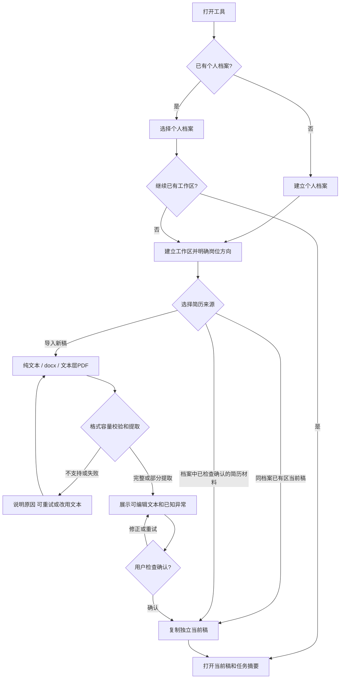
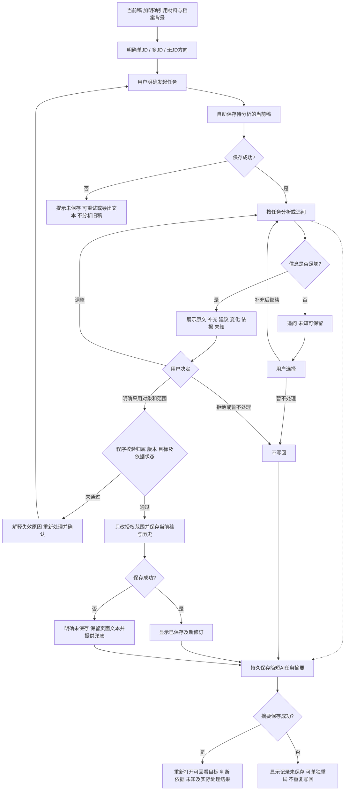
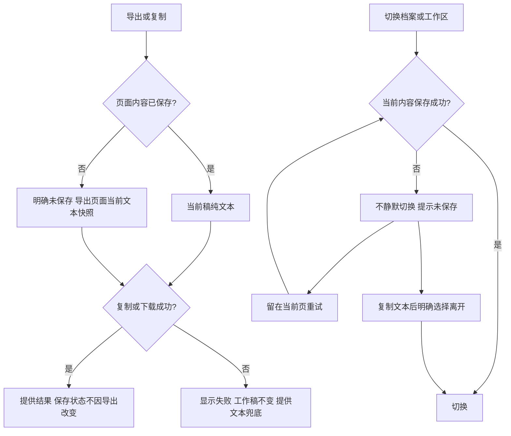

# AgentCV 产品流程与交互设计（草案）

> 依据已确认R01—R11及B01—B03；用户已确认本文的工作台交互结构和任务走读。视觉细节、响应式布局、可点击原型和软件行为尚未验证。原`中文简历处理工作流图.png`保留作历史资料。

## 1. 进入、建区与简历来源

复制或选取简历不确认经历真实性。新稿独立编辑，不覆盖来源；同一档案的已确认背景继续复用。若从来源工作区另建，辅助材料由用户选择沿用；JD、分析、任务记录和未采用建议不自动复制。未选定简历前工作区显示待完成初始化，不以空稿启动分析。

已有工作区内导入新简历，经检查确认后提供三个去向：更新当前稿（比较后整体替换/逐项采纳并保留历史）、另建一份、仅保存材料。重复文件先提示选择保留两份、比较更新或取消。

## 2. 用户任务、建议和写回

图中记录箭头表示关联关系，不要求用户额外点击才能记录。任务可追问、可无改稿；摘要记录失败独立显示。采用意图、写回和保存状态由实际程序结果产生。事实确认独立于采用：清楚陈述可同步，含糊/假设/冲突先澄清；展示同步结果并支持纠正/撤回。

用户暂不补充时可保留未知、结束本任务，不强制无限追问。切换目标可以建议新分析，但不能自动启动。旧建议原文变化、目标变化或依赖失效时不能直接采用。

已确认的一致性约束：分析前自动保存，失败不分析旧稿；同一次多项采用全部成功或全部失败，部分采用后其余旧建议暂停；成功保存保留修订，具体频率与简短历史展示待验证。上述保存门禁针对简历分析；用户仅查看记录或回答无需依赖当前稿的一般说明时不额外触发保存/分析。

## 3. 上下文变化、恢复、导出和离开

| 用户动作 | 界面和程序行为 |
| --- | --- |
| 切换JD/分析目标 | 说明当前选择；旧建议标明原目标并暂停采用；用户发起新分析后再决定 |
| 修改原文 | 保存状态随编辑更新；旧修订建议不能覆盖新原文 |
| 撤销引用/移除材料 | 展示影响；不再进入新分析，依赖建议暂停；已保存稿不自动改 |
| 更新材料 | 新内容待检查确认；旧依据建议暂停；历史摘要显示依据变化 |
| 纠正/撤回事实 | 展示记录结果；提示已识别相关内容；不自动改稿；依赖建议暂停 |
| 查看简历历史/任务摘要 | 只读查看，不自动运行分析、恢复引用或写回 |
| 恢复简历历史稿 | 明确选择后作为新当前修订，保留恢复前稿件；不回滚背景、不激活旧建议 |
| 删除档案/工作区/材料 | 展示归属影响并确认；进入可恢复回收站；材料仍作当前简历时先更换 |
| 恢复回收站对象 | 按设计保留规则恢复；关联冲突须处理；材料引用明确检查，不静默恢复分析输入 |

不承诺关闭页面后恢复未保存内容。未保存状态通过界面等元信息说明，不将提示语混入简历正文。

## 4. 交互区域建议

以下为信息结构建议，不绑定前端框架或固定布局。

| 区域 | 必须能理解的信息/操作 | 对应需求 |
| --- | --- | --- |
| 档案入口 | 当前人物、创建/切换、文件区、背景状态、回收站 | R01/R03/R08 |
| 工作区列表与初始化 | 当前方向及独立简历、三种来源、另建/继续、删除 | R02/R04 |
| 材料检查 | 原文件身份、可编辑提取文本、异常/确认/引用状态、重复文件选择 | R03 |
| 工作区目标与材料 | 本次选中的JD/方向及引用材料，不能混淆“已保存”和“本次参与分析” | R03/R06 |
| 当前简历 | 可编辑稿、保存状态、简历历史及导出 | R04/R09/R10 |
| 对话和建议对照 | 自然任务、补充、原文/变化/依据/未知、明确采用范围、失效原因 | R05/R07/R08 |
| AI任务记录 | 按工作区回看任务目标、简短判断、依据/未知、实际处理结果、摘要保存失败 | R11 |

## 5. 已确认的交互结构与待验证细节

用户已确认以下交互结构：左侧档案/工作区导航，中间唯一正式当前简历，右侧任务/对话/建议；材料、背景和回收站按需展开；对照默认展示原文/建议/变化，依据/补充/未知可展开；补充事实后可继续当前任务；简历历史与AI任务记录分开回看；保存、写回、摘要和导出失败分别显示真实状态。

- 三种来源选择、材料确认/引用合并操作、任务摘要展开方式需要界面原型验证。
- 自然语言授权有明确指代时不额外强制重复确认；有歧义则澄清，前后端都不得绕过状态校验。
- 关键保存/删除/恢复/摘要失败场景需通过可运行实现验证；本文流程核对不等于实现通过。
- 具体页面、接口字段、状态码和技术选型在后续详细设计补齐，不据流程图自行添加业务功能。